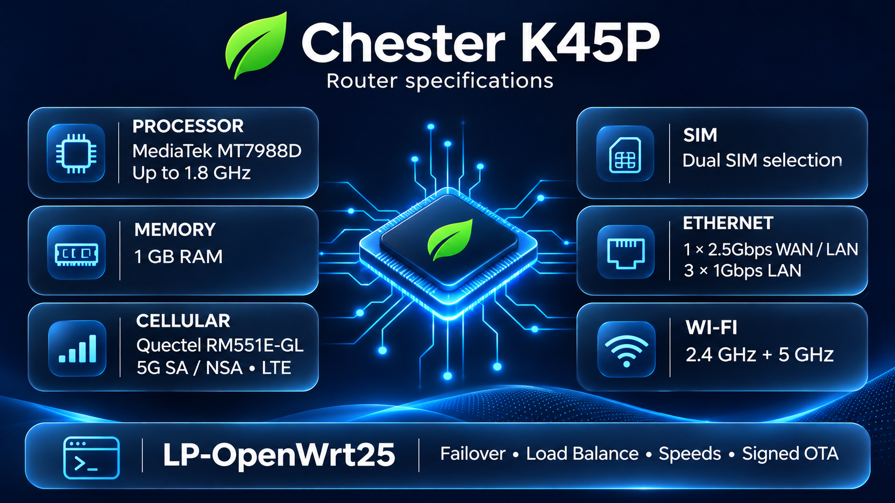

# Chester K45P



Custom firmware and OTA updates for the Chester K45P.

## Features

- Cellular overview, dual-SIM selection, APN and band controls.
- Failover and load balancing.
- Built-in Ookla and M-Lab speed tests.
- Wi-Fi, VLANs, fan control, TTL/HL and terminal.
- Sun/Night themes and signed OTA updates.

## Firmware

Latest published: **bin 10 · v1.0.9**.

[Download firmware](firmware/LettucePi-K45P-1.0.9-sysupgrade.itb) ·
[Release manifest](firmware/latest.json)

Use **Overview → Update** to install updates.
For fresh vendor routers, run [Update-K45P.cmd](scripts/Update-K45P.cmd).
The Windows installer erases saved settings.

Router address: `192.168.100.1` · Login: `root` / `admin`.
For K45P hardware only (`misectel,m02k45`). Vendor Linux 6.12.94 is retained.

Source changes after bin 10 are queued for the next image.

## Build

Use Linux/WSL with FIT, SquashFS, apk-tools 3 and OpenWrt fwtool:

```sh
APK_TOOLS=/path/to/apk3 FWTOOL=/path/to/fwtool \
  bash scripts/build.sh /path/to/K45-original-25.12.1.itb /var/tmp/k45p-build-new
```

[Base provenance](provenance.json) · [Release verification](firmware/SECURITY.md)
